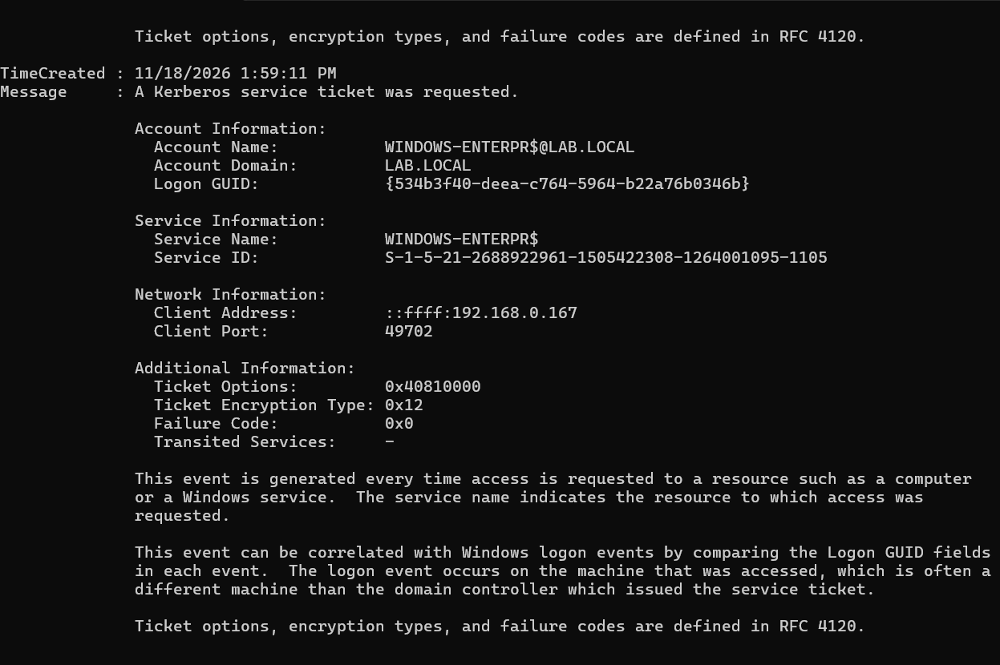
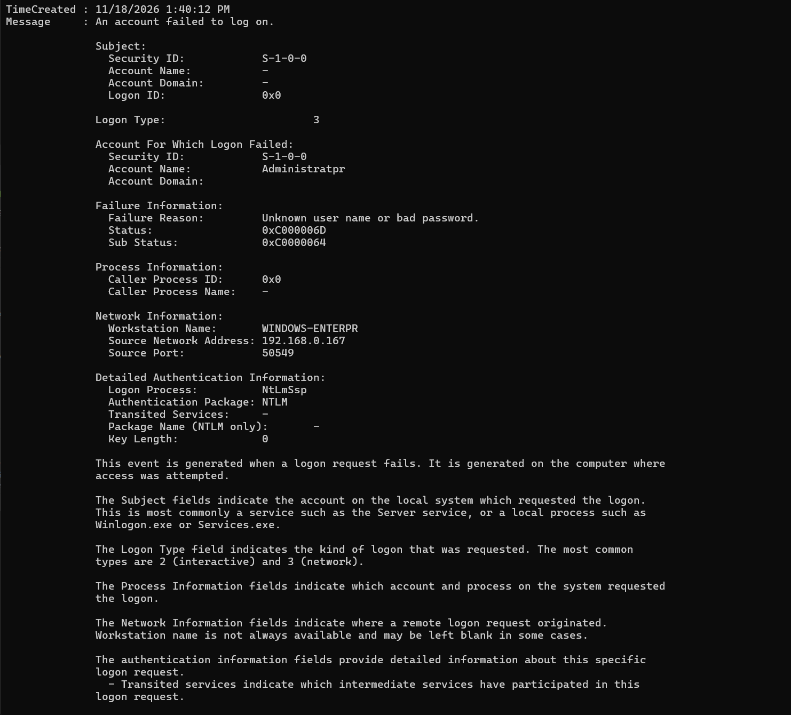
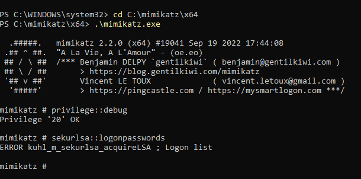
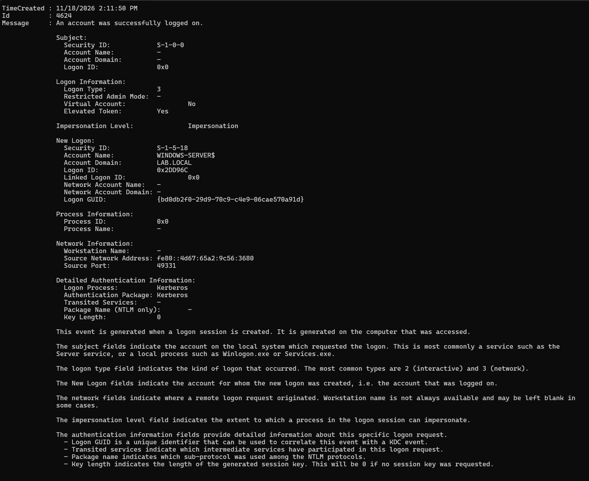

# Active Directory Detection Lab

## Overview
Home lab Active Directory environment used to generate and detect common attack techniques including Kerberos service ticket requests, failed logons, successful remote logons, and credential dumping attempts.

## Environment
- Windows Server (Domain Controller) - lab.local
- Windows 11 client joined to the domain
- Security event log monitoring

## Steps
1. Promoted Windows Server to Domain Controller (lab.local)
2. Joined Windows 11 client to the domain
3. Simulated Kerberos service ticket request
4. Simulated failed logon attempts
5. Simulated successful remote logon / lateral movement
6. Attempted Mimikatz credential dumping (blocked by protections)
7. Verified corresponding Security event logs

## Screenshots

## Result
Successfully generated and documented detection of multiple Active Directory attack techniques through Windows Security event logs.
